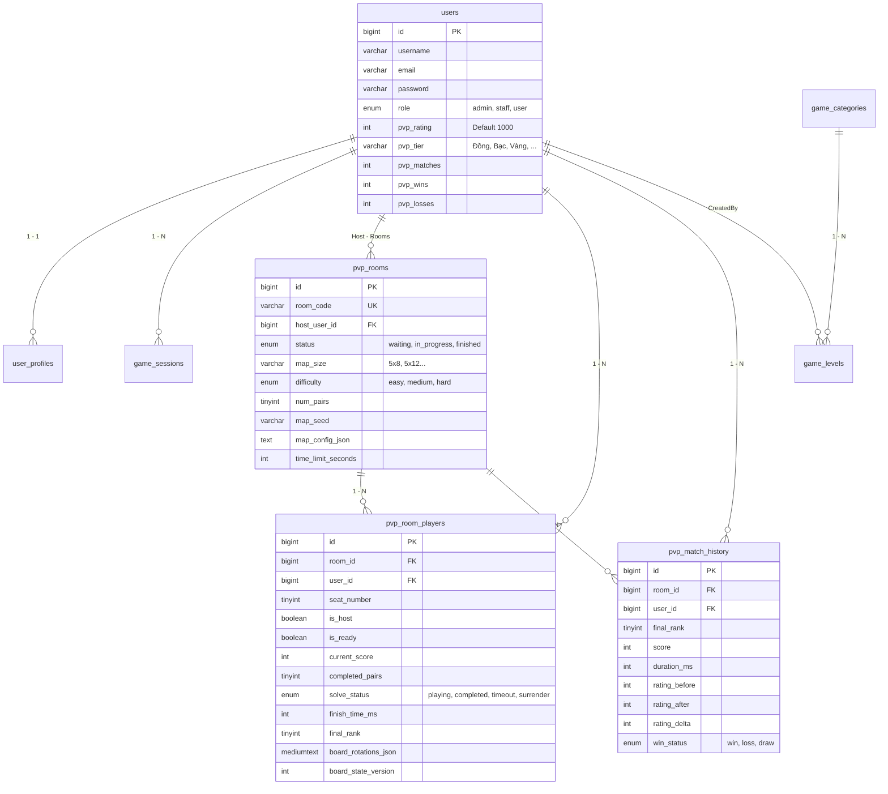

# KIẾN TRÚC HỆ THỐNG DỰ ÁN GAME NỐI ỐNG NƯỚC (HUIT PIPE GAME)
**Học phần:** Lập trình Mã Nguồn Mở PHP & Hệ thống Thời gian thực (HUIT)  
**Công nghệ chủ đạo:** PHP 8.3, Laravel 12 Hybrid Kernel, MySQL 8.0, Node.js WebSocket (RFC 6455), JavaScript ES6 Vanilla, Docker Compose.

---

## 1. TỔNG QUAN HỆ THỐNG (SYSTEM OVERVIEW)

Dự án **Game Nối Ống Nước** là một hệ thống web game hoàn chỉnh kết hợp giữa lập trình web hướng đối tượng (OOP PHP), kiến trúc MVC hiện đại (Laravel 12), cơ sở dữ liệu quan hệ (MySQL 8.0 qua PDO chuẩn hóa), trí tuệ nhân tạo (AI Search & Heuristic) và hệ thống thi đấu trực tuyến thời gian thực (Real-time PvP qua WebSockets).

```
+-----------------------------------------------------------------------------------+
|                              TRÌNH DUYỆT CLIENT                                   |
|                                                                                   |
|  +--------------------+  +----------------------+  +---------------------------+  |
|  | Single Player Game |  |  AI Bot Simulation   |  |   PvP Real-time Arena     |  |
|  |  (BanDoGame.js)    |  |    (CheDoAI.js)      |  | (PvpMatch.js, PvpLobby.js)|  |
|  +---------+----------+  +----------+-----------+  +-------------+-------------+  |
+------------|------------------------|----------------------------|----------------+
             |                        |                            |
      HTTP Fetch / REST API           |                   WebSocket (ws://:8080)
             |                        |                            |
+------------v------------------------v----------------------------v----------------+
|                        HỆ THỐNG MÁY CHỦ (BACKEND INFRASTRUCTURE)                   |
|                                                                                   |
|   +------------------------------------+    +---------------------------------+   |
|   |   Apache / PHP 8.3 Web Service     |    |   Node.js WebSocket Server      |   |
|   |          (Cổng 8000)               |    |          (Cổng 8080)            |   |
|   |                                    |    |                                 |   |
|   | - Hybrid Front Controller          |    | - Quản lý kết nối Client        |   |
|   | - API Controllers (Auth, Game, PvP)|    | - Phòng thi đấu (Channels)      |   |
|   | - Server Authority Validation      |    | - Presence & Ping/Pong          |   |
|   | - Elo Pairwise Zero-Sum Engine     |    | - HTTP Broadcast Receiver       |   |
|   +-----------------+------------------+    +----------------+----------------+   |
|                     |                                        |                    |
|                     +------------ HTTP Broadcast ------------+                    |
|                                (Cổng nội bộ 8080)                                 |
+-------------------------------------|---------------------------------------------+
                                      |
                           PDO MySQL Prepared Statements
                                      |
+-------------------------------------v---------------------------------------------+
|                            CƠ SỞ DỮ LIỆU MYSQL 8.0                                 |
|                                  (Cổng 3307)                                      |
|                                                                                   |
| - Users & RBAC (Admin, Staff, User)       - Game Sessions & Telemetry Logs        |
| - Levels & Map Configurations             - PvP Rooms & Player States             |
| - Ranked Leaderboard & Elo History        - Password Reset OTPs & Sessions        |
+-----------------------------------------------------------------------------------+
```

---

## 2. KIẾN TRÚC TẦNG (TIERED ARCHITECTURE)

Hệ thống được thiết kế theo mô hình 4 tầng phân tách trách nhiệm rõ ràng (Separation of Concerns):

### 2.1. Tầng Trình diễn (Presentation Layer - Frontend)
- **Công nghệ:** HTML5, CSS3 hiện đại (Flexbox, CSS Grid, Animation, Dark Neumorphism), JavaScript ES6 thuần (Vanilla JS, không phụ thuộc framework cồng kềnh, tối ưu hiệu năng render 60 FPS).
- **Thành phần chính:**
  - `TrangChu.html` / `index.html`: Sảnh chính, đăng nhập/đăng ký, chọn chế độ chơi, cấu hình ma trận, bảng xếp hạng tổng và bảng xếp hạng Elo PvP.
  - `TrangGame.html`: Bàn cờ thi đấu 60 ô (ma trận 5x12), hệ thống render SVG ống nước và dòng chảy nước động (`SVGnuoc.js`).
  - `PvpSocket.js`: Client WebSocket chuẩn tương thích Laravel Echo, hỗ trợ tự động kết nối lại (Auto-reconnect), Presence channel và đồng bộ trạng thái bàn cờ.
  - `PvpMatch.js`: Quản lý giao diện thi đấu PvP, đồng hồ đếm ngược, thanh tiến trình đối thủ và bảng xếp hạng trực tiếp kéo thả/thu gọn.

### 2.2. Tầng Ứng dụng & Điều phối (Application / Controller Layer)
- **Công nghệ:** Laravel 12 Hybrid Kernel kết hợp MVC tiêu chuẩn.
- **Thành phần chính:**
  - `bootstrap/huit_hybrid_kernel.php`: Bộ điều phối trung tâm tiếp nhận tất cả HTTP Requests, xử lý routing, session, CORS và phân luồng tới Controller tương ứng.
  - `app/Http/Controllers/Api/GameApiController.php`: Xử lý đăng ký, đăng nhập, bảo mật mật khẩu, cấp phát OTP 60 giây, lưu phiên chơi Single Player và tìm kiếm màn chơi.
  - `app/Http/Controllers/Api/PvpApiController.php`: Xử lý toàn bộ vòng đời trận đấu PvP: tạo phòng, ghép trận ngẫu nhiên, sẵn sàng, bắt đầu trận, nộp nước đi, nộp bài giải và lấy bảng xếp hạng Rank.

### 2.3. Tầng Dịch vụ & Xử lý Nghiệp vụ (Service / Domain Layer)
- **Thành phần chính:**
  - `app/Services/PvpMatchService.php`: Máy trạng thái trận đấu (Match Lifecycle State Machine), điều phối phòng chờ, chặn bắt đầu khi chưa đủ người/chưa sẵn sàng (AC2 - Room Discipline), quản lý nộp bài và kết thúc trận.
  - `app/Services/PvpBoardStateService.php`: **Server Authority Engine (AC1)** — quản lý phiên bản bàn cờ (`board_state_version`), thẩm định tính hợp lệ của từng lượt xoay ống/hoán đổi, chạy thuật toán BFS kiểm tra tính thông suốt hai chiều và tính điểm trừ đường vòng.
  - `app/Services/PvpRatingService.php`: **Elo Pairwise Engine (AC6)** — tính toán điểm xếp hạng Elo đa người chơi (2 đến 4 người) theo nguyên lý đối ứng Zero-Sum ($ \sum \Delta \text{Elo} = 0 $), gán bậc xếp hạng (Đồng, Bạc, Vàng, Bạch Kim, Kim Cương, Cao Thủ).
  - `app/Services/PvpMapService.php`: **Seed Uniformity Engine (AC3)** — sinh bản đồ giả ngẫu nhiên có kiểm soát bằng thuật toán Winding DFS kết hợp seed cố định, đảm bảo tất cả người chơi trong phòng nhận cùng 1 cấu hình bản đồ.
  - `app/Services/PdoDatabaseService.php`: Lớp truy xuất cơ sở dữ liệu PDO an toàn tuyệt đối chống SQL Injection, tự động bảo trì schema CSDL (`ensurePvpSchema`).
  - `app/Domain/PipeGame/Engine/PipeBoardSimulator.php`: Mô hình OOP đa hình (Polymorphism) mô phỏng bàn cờ, minh họa kiến trúc hướng đối tượng của học phần.

### 2.4. Tầng Dữ liệu & Cơ sở Hạ tầng (Data & Infrastructure Layer)
- **Cơ sở dữ liệu:** MySQL 8.0 (InnoDB, UTF-8 MB4 Unicode) chạy trên cổng `3307` (nội bộ container `3306`), có sẵn cơ chế dự phòng tự động chuyển sang SQLite PDO nếu môi trường local chưa kích hoạt MySQL.
- **WebSocket Broadcast:** Node.js Server (`websocket-server/server.js`) chạy cổng `8080`, hỗ trợ broadcast hai chiều giữa máy chủ PHP và các trình duyệt client.
- **Containerization:** Docker Compose phối hợp 3 dịch vụ: `app` (PHP 8.3 Apache), `db` (MySQL 8.0) và `phpmyadmin` (Quản trị CSDL trực quan trên cổng 8081).

---

## 3. CÂY THƯ MỤC CHI TIẾT DỰ ÁN (PROJECT DIRECTORY TREE)

```text
GameNoiOngNuoc/
├── .docs/                                # Thư mục tài liệu kỹ thuật dự án
│   ├── ARCHITECTURE.md                  # Tài liệu kiến trúc hệ thống & cây thư mục
│   └── ALGORITHM.md                     # Tài liệu các thuật toán AI & Logic toán học
├── app/                                 # Mã nguồn Backend PHP (Laravel & OOP Services)
│   ├── Domain/                          # Tầng nghiệp vụ lõi (Domain-Driven Core)
│   │   └── PipeGame/Engine/             # Bộ mô phỏng bàn cờ ống nước đa hình (OOP)
│   │       ├── PipeBoardSimulator.php   # Lớp điều phối mô phỏng bàn cờ
│   │       ├── PipeCell.php             # Lớp trừu tượng đại diện ô cờ
│   │       ├── StraightPipe.php         # Ống thẳng kế thừa PipeCell
│   │       ├── CornerPipe.php           # Ống chữ L kế thừa PipeCell
│   │       └── CrossPipe.php            # Ống chữ thập kế thừa PipeCell
│   ├── Events/Pvp/                      # Các sự kiện PvP Real-time (Event Broadcasting)
│   │   ├── MatchStarted.php             # Sự kiện trận đấu chính thức bắt đầu
│   │   ├── PlayerProgressUpdated.php    # Sự kiện người chơi cập nhật tiến độ
│   │   ├── PlayerCompleted.php          # Sự kiện người chơi hoàn thành bài thi
│   │   ├── MatchEnded.php               # Sự kiện trận đấu kết thúc
│   │   └── MatchResultsPublished.php    # Sự kiện công bố kết quả và delta Elo
│   ├── Http/Controllers/Api/            # Các bộ điều khiển API RESTful
│   │   ├── GameApiController.php        # API Auth, Đăng ký, Đăng nhập, Session, OTP
│   │   └── PvpApiController.php         # API Quản lý phòng, Ghép trận, Nước đi, Nộp bài
│   ├── Models/                          # Các Eloquent Models (User, Level, Session, ...)
│   └── Services/                        # Các tầng dịch vụ chuyên sâu (Core Services)
│       ├── PdoDatabaseService.php       # Tầng kết nối PDO & thực thi SQL prepared
│       ├── PvpBoardStateService.php     # Xác thực bàn cờ phía Server & thuật toán BFS
│       ├── PvpMapService.php            # Sinh bản đồ theo Seed (AC3 Seed Uniformity)
│       ├── PvpMatchService.php          # Vòng đời trận đấu PvP & kiểm soát phòng chờ
│       ├── PvpRatingService.php         # Thuật toán xếp hạng Elo Pairwise Zero-Sum
│       ├── PvpRoomService.php           # Tạo phòng, tham gia, đổi cấu hình, sẵn sàng
│       └── BroadcastingService.php      # Gửi gói tin HTTP Broadcast sang WebSocket
├── bootstrap/                           # Khởi động ứng dụng
│   ├── app.php                          # Khởi tạo Laravel Kernel
│   └── huit_hybrid_kernel.php           # Front Controller tích hợp cho Apache/Docker
├── config/                              # Cấu hình hệ thống (app, database, broadcasting)
├── database/                            # Cơ sở dữ liệu và chuyển đổi cấu trúc (Migrations)
│   ├── migrations/                      # Các file migration chuẩn Laravel & MySQL
│   │   ├── 2026_10_17_000001_add_board_state_to_pvp_players.php
│   │   └── 2026_10_17_000001_add_board_state_to_pvp_players.sql
│   └── sql/                             # File nạp cấu trúc & dữ liệu ban đầu
│       └── huit_water_pipe_db.sql       # Script khởi tạo 11 bảng MySQL & dữ liệu mẫu
├── docker/                              # Cấu hình container Docker
│   ├── apache/000-default.conf          # Cấu hình VirtualHost Apache document root public/
│   └── entrypoint.sh                    # Script khởi động tự động trong container
├── public/                              # Tài nguyên công khai (Client Assets & Views)
│   ├── CSS/                             # File định dạng giao diện
│   │   ├── TrangChu.css                 # CSS trang chủ, modal đăng nhập, lobby
│   │   └── TrangGame.css                # CSS bàn cờ, ống nước, hiệu ứng phát sáng
│   ├── Images/                          # Tài nguyên hình ảnh, cúp sao, nền caro
│   │   ├── OngXanh/                     # Ống xanh có thể xoay (Thang, ChuL, ChuThap)
│   │   ├── OngVang/                     # Ống vàng cho phép tráo đổi vị trí
│   │   ├── OngDo/                       # Ống đỏ chướng ngại vật cố định
│   │   └── svg/Nut/                     # Các nút chức năng (Cài đặt, Thoát, Bắt đầu)
│   ├── JS/                              # Mã nguồn JavaScript phía Client
│   │   ├── TrangChu/
│   │   │   ├── DangnhapDangky.js        # Xử lý form đăng nhập, đăng ký, quên mật khẩu
│   │   │   ├── PvpLobby.js              # Quản lý sảnh chờ PvP, mã phòng, nút sẵn sàng
│   │   │   └── TrangChu.js              # Khởi tạo sảnh chính và âm thanh
│   │   └── TrangGame/
│   │       ├── BanDoGame.js             # Logic bàn cờ Single Player & BFS kiểm tra nước
│   │       ├── CheDoAI.js               # Thuật toán AI Hill Climbing & Random Restart
│   │       ├── PvpMatch.js              # Quản lý trận đấu PvP, leaderboard di động
│   │       ├── PvpSocket.js             # Giao tiếp WebSocket, presence channel
│   │       ├── SVGnuoc.js               # Vẽ dòng nước động trong ống SVG
│   │       └── TrangGame.js             # Điều phối giao diện trong trận đấu
│   ├── Sounds/                          # Âm thanh hiệu ứng game (click, xoay, chảy nước)
│   ├── index.html                       # Trang chủ ứng dụng (Single Page Application)
│   ├── index.php                        # Điểm vào chính của Backend PHP
│   └── TrangGame.html                   # Giao diện màn hình bàn cờ game
├── resources/views/                     # Các mẫu giao diện Blade (HUIT Portal MVC)
│   ├── auth/                            # Giao diện đăng nhập, quản lý quyền
│   ├── levels/                          # Giao diện CRUD màn chơi (Resource Controller)
│   ├── oop-lab/                         # Giao diện thực hành hướng đối tượng
│   ├── pdo-lab/                         # Giao diện kiểm thử truy vấn PDO SQL
│   └── portal/                          # Bảng điều khiển quản trị viên HUIT
├── routes/                              # Định nghĩa tuyến đường HTTP
│   ├── api.php                          # Toàn bộ API endpoints RESTful & PvP
│   └── web.php                          # Tuyến đường giao diện web Blade
├── tests/                               # Kiểm thử tự động (Automated Test Suite)
│   ├── Feature/
│   │   └── GameProjectTest.php          # 23 ca kiểm thử Unit & Feature cho Core Game
│   └── run_tests.php                    # Script thực thi toàn bộ test suite trong 1 lệnh
├── websocket-server/                    # Máy chủ WebSocket độc lập
│   └── server.js                        # WebSocket Server thuần Node.js RFC 6455
├── docker-compose.yml                   # Cấu hình triển khai đa container
├── Dockerfile                           # Định nghĩa Image PHP 8.3 Apache + PDO MySQL
├── README.md                            # Hướng dẫn khởi chạy dự án cho thành viên mới
├── run-tests.bat                        # File batch chạy kiểm thử 1-click trên Windows
└── setup.bat                            # File batch tự động dựng môi trường 1-click
```

---

## 4. MÔ HÌNH DỮ LIỆU CƠ SỞ (DATABASE SCHEMA)

Cơ sở dữ liệu `huit_water_pipe_db` được chuẩn hóa bậc 3 (3NF) với 11 bảng:



---

## 5. QUY TRÌNH TRAO ĐỔI THÔNG TIN REAL-TIME (PVP FLOW)

1. **Tạo/Tham gia phòng:** Client gửi request HTTP tới `/api/pvp/create-room` hoặc `/api/pvp/join-room`. Backend lưu đấu thủ vào CSDL và broadcast sự kiện `RoomPlayerJoined` qua WebSocket.
2. **Sẵn sàng (Ready Check):** Đấu thủ gửi `/api/pvp/toggle-ready`. Khi đủ người mục tiêu và $100\%$ sẵn sàng, nút "Bắt đầu" của chủ phòng sáng lên (AC2 - Room Discipline).
3. **Bắt đầu trận (Match Start):** Chủ phòng bấm Bắt đầu, Server sinh Seed ngẫu nhiên, lưu vào `pvp_rooms` và phát `MatchStarted` mang theo seed bản đồ tới toàn bộ người chơi (AC3 - Seed Uniformity).
4. **Đồng bộ thao tác & Kiểm tra gian lận (Progress & Server Authority):**
   - Khi người chơi xoay ống, client gửi tọa độ tới `/api/pvp/submit-move`.
   - Server thẩm định tính hợp lệ của ô (không cho xoay ống đỏ/đầu mút/ống vàng), cập nhật `board_rotations_json`, chạy thuật toán BFS độc lập phía Server tính điểm tạm thời (tối đa 99 điểm, chặn mọi cờ thắng giả từ client).
   - Server phát `MatchLeaderboardUpdated` để cập nhật vị trí bảng xếp hạng trực tiếp giữa các người chơi.
5. **Nộp bài thi & Hoàn tất (Authoritative Solution Submission):**
   - Người chơi hoàn thành gửi `/api/pvp/submit-solution`.
   - Backend lấy trạng thái bàn cờ từ CSDL chạy BFS thẩm định: chỉ khi $100\%$ các cặp thông suốt và điểm đạt đúng 100đ mới công nhận `solve_status = 'completed'` và cấp Rank theo thứ tự thời gian.
6. **Kết thúc trận & Cập nhật Rank (Finalize & Elo Update):**
   - Khi tất cả đã hoàn thành hoặc hết giờ, Server chạy `PvpRatingService::calculateMatchEloDeltas`, tính toán biến thiên điểm Elo Pairwise Zero-Sum và ghi lịch sử vào `pvp_match_history`.
