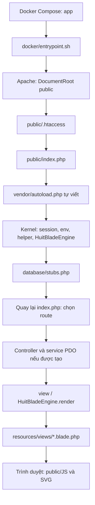

# Bản đồ mã nguồn WaterPipeConnection

Đối chiếu ngày **28/10/2026**, múi giờ Asia/Saigon. Đây là bản đồ khảo sát có chọn lọc, không phải xác nhận mọi chức năng đều chạy được. Trạng thái môi trường và kết quả chạy nằm trong [WORK_STATUS.md](WORK_STATUS.md).

## Mục lục

- [Luồng khởi động, Docker và view](#boot)
- [Chơi đơn](#single)
- [AI](#ai)
- [PvP và WebSocket](#pvp)
- [Tài khoản, phân quyền, quản trị](#accounts)
- [Dữ liệu, migration và SQLite](#data)
- [Khác biệt và điểm cần thận trọng](#differences)
- [Tra cứu theo nhiệm vụ tiếp theo](#tasks)

Cách dùng: đọc [AGENTS.md](../AGENTS.md) → trạng thái ngắn gọn → mục chức năng dưới đây → mã hiện tại và phụ thuộc trực tiếp. Tìm symbol bằng `rg -n` rồi đọc đoạn; số dòng có thể thay đổi. Các mô tả dưới đây là **đối chiếu tĩnh**, trừ khi ghi rõ đã chạy. Tài liệu tham khảo đã đọc mục lục/đề mục và phần liên quan: [ARCHITECTURE.md](ARCHITECTURE.md) §§2–5, [ALGORITHM.md](ALGORITHM.md) mục lục và §§1–7; các khẳng định được kiểm tra lại bằng code.

## 1. Luồng khởi động, Docker và view

File tĩnh tồn tại được Apache phục vụ trực tiếp; không phải mọi request đều qua PHP.

| Chặng | Bằng chứng và vai trò |
| --- | --- |
| Compose → app | [docker-compose.yml](../docker-compose.yml), service `app`: build [Dockerfile](../Dockerfile), ánh xạ `8000:80`, bind mount dự án vào `/var/www/html`, DB nội bộ `db:3306`; chỉ `depends_on`, không có healthcheck chờ DB sẵn sàng. |
| Image → Apache | Dockerfile dùng `php:8.3-apache`, cài PDO MySQL/SQLite và mysqli, bật `rewrite`/`headers`, chép virtual host. [entrypoint.sh](../docker/entrypoint.sh) chạy `chmod -R 777 /var/www/html`, rồi `exec apache2-foreground`; không chạy Composer/migration. Không chạy lại entrypoint trong khảo sát. |
| Virtual host → front controller | [000-default.conf](../docker/apache/000-default.conf) đặt `DocumentRoot /var/www/html/public`, `AllowOverride All`; [public/.htaccess](../public/.htaccess) rewrite đường dẫn không phải file/thư mục sang `index.php`. |
| Autoload | [vendor/autoload.php](../vendor/autoload.php): `spl_autoload_register()` ánh xạ `App`, `Database\Factories`, `Database\Seeders`; sau đó `require_once` kernel và stub. Thư mục vendor hiện chỉ có file này. [composer.json](../composer.json) khai báo Laravel 12 nhưng không chứng minh framework được boot. |
| Kernel tự viết | [huit_hybrid_kernel.php](../bootstrap/huit_hybrid_kernel.php): `session_start()`, đọc `.env` chỉ khi biến môi trường chưa tồn tại, tạo token, helper `route()`, `redirect()`, `abort()`, `view()`. Routing HTTP nằm ở index, không nằm ở kernel này. |
| Render view | Cùng kernel: `view()` echo và `exit`; `HuitBladeEngine::render()` tìm `resources/views/<tên view>.blade.php`, `compileString()` biên dịch cú pháp Blade hỗ trợ, `evaluatePhp()` thực thi PHP. `route()` là bảng tên route tự viết, độc lập với `routes/*.php`. |
| Stub framework | [database/stubs.php](../database/stubs.php): `Illuminate\Support\Facades\Auth`, `Schema`, model/query/request… là lớp thay thế; nhiều hàm trả giá trị rỗng hoặc không làm gì. Không suy ra Eloquent/Auth/Migration thật từ tên namespace. |

Riêng avatar Profile đã có [bootstrap/avatar_storage.php](../bootstrap/avatar_storage.php) nạp **lười** Composer autoload riêng trong `bootstrap/avatar-storage/vendor`. Đây là Storage/Filesystem thật, không phải boot framework; root autoloader/kernel/dispatcher và các stub hiện có giữ nguyên. Manifest/lockfile và cách tái tạo nằm trong [avatar-storage/README.md](../bootstrap/avatar-storage/README.md).

`public/index.php` nạp autoloader trước, chuẩn hóa URI, hỗ trợ POST `_method`, kiểm tra CSRF cho Web POST/PUT/PATCH/DELETE; nhánh `/api/` được miễn kiểm tra CSRF tại đây. POST `/api/game/scoring-baseline` gọi thẳng `PipeScoringService::baseline()` (không tạo PDO), giới hạn body 64 KiB và bỏ chứng nhận do client gửi. Các route còn lại gọi controller trực tiếp và kết thúc bằng `abort(404)` nếu không có route phù hợp.

| Route thực tế trong [public/index.php](../public/index.php) | Đích |
| --- | --- |
| GET `/`, `/index.html`, `/game/home` | `GamePlayController::home()` → `game.home`. |
| GET `/TrangGame.html`, `/game/play` | `GamePlayController::play()` → `game.play`. |
| GET/POST `/profile` | `PlayerProfileController::show/update()`; session chính chủ, Web CSRF, service PDO và view `game.profile`. Không có route hồ sơ công khai hoặc tham số user ID. |
| GET `/admin`, `/oop-lab`, `/pdo-lab` | Guard session role `admin` ngay trong index; lần lượt `GamePlayController::portal()`, `oopLab()`, `PdoLabController::index()`. |
| `/levels`, `/levels/{id}`, `/levels/{id}/edit`, `/levels/page/{page}`, `/levels/slug/{slug}` và create/update/delete | `GameLevelController` cùng các điều kiện method/regex ở index. |
| `/api/auth/*`, các alias `/api/login`, `/api/register`, `/api/me`… | `GameApiController`; OTP dùng các nhánh send/resend/verify/reset riêng. |
| `/api/game/*`, `/api/leaderboard`, `/api/levels/search` | `GameApiController::saveSession()`, `resetScore()`, `leaderboard()`, `searchLevels()`. |
| `/api/pvp/*` | Bảng `match` gọi `PvpApiController`; xem §4. |
| `/api/admin/users/{id}/pvp-history`, `/api/admin/test-map-seed` | Closure/nhánh trực tiếp trong index, gọi service; không có guard admin tương ứng trong các nhánh này. |
| Web `/login`, `/register`, `/logout`, `/admin/users/{id}/role`, `/admin/users/{id}/toggle-active` | `AuthController`; phân biệt nhánh Web này với API đăng nhập thật của trang chủ (§5). |

Không thấy `public/index.php` hoặc autoloader nạp [bootstrap/app.php](../bootstrap/app.php), [routes/web.php](../routes/web.php), [routes/api.php](../routes/api.php). `bootstrap/app.php` khai báo bootstrap Laravel và middleware alias, nhưng không phải chặng trong luồng hiện tại. [artisan](../artisan) cũng là CLI tự viết, không boot file này.

Hai view chính là [game/home.blade.php](../resources/views/game/home.blade.php), [game/play.blade.php](../resources/views/game/play.blade.php). View play nạp theo thứ tự: `TrangGame.js` → `SVGnuoc.js` → `PipeScore.js` → `BanDoGame.js` → `CheDoAI.js` → dữ liệu auth inline → `PvpSocket.js` → `PvpActionQueue.js` → `PvpMatch.js`. Đây là các script global, không phải module ES. Giữ đúng `public/JS`, `public/Images`, `resources/views`. View dùng URL asset tương đối; các alias sâu như `/game/play` cần kiểm tra tải asset riêng, chưa được thử trên trình duyệt.

## 2. Chơi đơn

Điểm vào PHP: [GamePlayController.php](../app/Http/Controllers/GamePlayController.php) `home()` lấy leaderboard; `play()` truyền user vào view. Constructor cả hai đường đều tạo `PdoDatabaseService`, nên request GET cũng có thể kích hoạt bảo trì schema (§6).

| Chức năng | File, hàm và quan hệ |
| --- | --- |
| Chọn chế độ và cấu hình | [TrangChu.js](../public/JS/TrangChu/TrangChu.js), listener nút bắt đầu: ghi `gameMode=player`, `mapOption`, `mapSize`, `difficulty`, `numPairs` vào sessionStorage; xóa điểm lượt trong localStorage. PvP chuyển sang `PvpLobby.handleStartPvP()`. |
| Khởi tạo bàn | [BanDoGame.js](../public/JS/TrangGame/BanDoGame.js), listener `DOMContentLoaded`: dựng lưới nền 5×12, tạo phần tử ống bằng `themAnhVaoO()` nội bộ, chọn map, gọi `napBanDoTuDatabaseLenUI()`, HUD, timer và `capNhatLuongNuoc()`. |
| Kho map trong bộ nhớ | Cùng file, `khoiTao24BanDoTrongDatabase()` tạo 8 kích thước × 3 độ khó trong object `customMapDatabase` bằng seed cố định theo kích thước/độ khó/số cặp. Tên “Database” không có nghĩa đọc SQL. `random` chọn ngẫu nhiên một kích thước trong kho này; `custom` chọn theo cấu hình. |
| Sinh bản đồ | Cùng file, `taoDuLieuMotBanDo()` → `taoBoSinhSoTheoSeed()`, `tinhThongSoManChoi()`, `timDuongUonLuonZicZacDFS()`, `xacDinhHinhDangVaGocDung()`. Chia vùng cho từng cặp; DFS có quay lui, ưu tiên khúc cua, giới hạn tìm kiếm và fallback Manhattan; sau đó đặt ống nhiễu/khóa/tường theo độ khó và xáo cụm vàng. |
| Trạng thái bàn | `napBanDoTuDatabaseLenUI()` đưa `mapData.cells` vào DOM/dataset và `mapData.pipes` vào `window.danhSachDuongOng`. Góc xoay, loại ống và vị trí lấy từ DOM; `daKetNoiThanhCong`, `window.isGameOver`, `window.isGamePaused` điều khiển tương tác. |
| Xoay và đổi ống | Listener click `.KhungGame` trong BanDoGame: xanh `.co-the-xoay` xoay 90°; vàng `.co-the-trao-doi` đổi với ô vàng kề Manhattan=1 qua `swapPipeContents()` nội bộ; ô gợi ý đã khóa không tương tác. Sau thao tác gọi `capNhatLuongNuoc()`. |
| Kiểm tra kết nối | `layThongTinOngTaiO()` → `kiemTraKetNoiCapDuongOngBFS()` kiểm tra cổng mở hai chiều, đi từ start đến end đúng cặp, trả `bfsDistance`, `totalFlowCells`, `flowTrace`. `resetNuoc()` và các hàm hiệu ứng dùng SVG từ [SVGnuoc.js](../public/JS/TrangGame/SVGnuoc.js). |
| Điểm và thắng | `capNhatLuongNuoc()` đo bước BFS tới đúng đích; [PipeScore.js](../public/JS/TrangGame/PipeScore.js) `score()` tính trung bình `100 × (L_chuan/L_thuc)^2`, chỉ làm tròn tổng. Đủ cặp thì hoàn thành, kể cả đường vòng. `is_optimal` so độ dài thật. `napChuanDiemBanDau()` lấy chuẩn cho map ban đầu một lần qua endpoint thuần; gợi ý/AI không phải nguồn chuẩn. |
| Timer và thua | BanDoGame `khoiTaoDongHoThoiGianTheoDoKho()` dùng `thinkingTimeMs`, hết giờ gọi [TrangGame.js](../public/JS/TrangGame/TrangGame.js) `xuLyThuaGame()` → cờ game over, dừng timer, modal và `capNhatThongKeUser('thua')`. |
| Thống kê và lưu phiên | TrangGame `capNhatThongKeUser()` được bọc ở cuối file để gọi `window.guiKetQuaManChoiLenServer()` → POST `/api/game/save-session` → [GameApiController.php](../app/Http/Controllers/Api/GameApiController.php) `saveSession()` → [PdoDatabaseService.php](../app/Services/PdoDatabaseService.php) `recordGameSession()`. Lưu kết quả/độ khó/điểm/steps/retry/duration/telemetry JSON vào `game_sessions`, cập nhật thống kê user ở chế độ player. Không lưu toàn bộ bàn để resume chơi đơn. |

Điểm chất lượng 0–100/nullable nằm trong `window.danhGiaDiem` và `score_earned` của phiên luật mới; không ghi đè `localStorage.tongDiem`. `congDiem(100)` vẫn là thưởng tích lũy khi thắng và chạy trước hook lưu phiên. Telemetry chứa `scoring_version`, `quality_score`, `score_status`, `is_optimal`, `reward_points`; `users.high_score` giữ ý nghĩa thưởng cũ, không reset lịch sử. `getRecentSessions()` gắn nhãn điểm luật mới/điểm cũ/chưa xác định; `getGameModeTelemetryAnalytics()` chỉ dùng `telemetry_nosql.quality_score` cho AVG/MAX chất lượng, không trộn thưởng cũ.

`recordGameSession()` vẫn tin số liệu chơi đơn (không phải anti-cheat server). `guiKetQuaManChoiLenServer()` bỏ qua PvP để không ghi nhầm thành player. PvP dùng board/điểm/lịch sử riêng. Không thay schema hoặc sửa các bản ghi đã có.

### 2.1. Chuẩn tối ưu dùng chung

[PipeScoringService.php](../app/Services/PipeScoringService.php) `solve()` duyệt tăng cận tổng số bước, với cận dưới BFS thư giãn có kiểm hướng/khúc cua. DFS duyệt các đường đơn đồng thời: yêu cầu cổng dùng chung một ô phải nằm trong cùng một cấu hình ống. Xanh có bốn góc; đỏ/đầu mút cố định; tường không có cổng; thập là một nút nối chung đúng engine hiện hành. Trong mỗi cụm vàng liên thông, ghép cặp có sức chứa kiểm đủ số token/hướng; mọi hoán vị token trong cụm thực hiện được bằng các swap kề nhau. Vì duyệt hết mọi tổ hợp dưới cận và mọi vector độ dài ở tổng nhỏ nhất trước khi trả `proven`, đây là chứng minh tối ưu đồng thời, không phải ghép đường riêng hoặc coi Manhattan/đường sinh map là chuẩn.

Giới hạn: tối đa 60 ô trong lưới 5×12, 1–4 cặp; mặc định 150.000 nút/250 ms. Hết ngân sách kể cả đã thấy ứng viên nhưng chưa thu đủ các vector tương đương → `unproven`, không công bố tối ưu. `unsatisfiable`/`invalid`/không kết nối được endpoint đều phân biệt. `baseline()` cache theo phiên bản thuật toán + topology/loại ống/góc đầu/cụm vàng/đầu mút; PvP lưu trong map JSON, fallback cache riêng `storage/app/scoring-cache` cho solo/trận cũ (không nằm trong public). Không giải lại mỗi click. Cache chỉ giữ độ dài và chứng nhận, không giữ đường/góc giải.

`score()` chọn điểm cao nhất trong các vector tối ưu có độ dài chuẩn không lớn hơn từng đường đang nối; mọi vector tối ưu tương đương đạt 100. Đường ngắn hơn chứng nhận kích hoạt kiểm lại chuẩn có cache. Nếu vẫn không có vector so sánh được, `quality_score=null`, `score_status=incomparable_lengths` theo quyết định người dùng; vẫn xét hoàn thành bằng kết nối. Chuẩn unproven/unsatisfiable hoặc endpoint offline cũng không bị thay bằng chuẩn giả; bàn vẫn chạy và hiển thị số cặp đã nối. Cột integer cũ lưu 0 khi chất lượng chưa xác định, JSON đi kèm giữ null/trạng thái; xếp hạng dùng giá trị tương thích này và hoàn thành riêng. Không suy ra tối ưu từ số 100 đã làm tròn.

`game_levels` CRUD là dữ liệu quản lý riêng: [levels/show.blade.php](../resources/views/levels/show.blade.php) `napCauHinhVaVaoGame()` chỉ truyền kích thước/độ khó qua sessionStorage rồi mở `/TrangGame.html`; chưa thấy đường tải `map_config_json` của level vào engine JS hoặc gắn `game_level_id` khi `recordGameSession()` lưu.

## 3. AI

Nguồn chính: [CheDoAI.js](../public/JS/TrangGame/CheDoAI.js), được view play nạp nhưng **chưa xác minh có luồng kích hoạt AI hoạt động** trong giao diện hiện tại.

| Thành phần | Symbol và hành vi trong code |
| --- | --- |
| Điểm vào | `khoiChayAI()` yêu cầu `gameMode === 'ai'`, đọc `sessionStorage.solutionPath`, reset stats rồi gọi Easy/Medium hoặc Hard. `kichHoatAI_DauHang()` cũng cần solutionPath; được listener đầu hàng trong TrangGame gọi. Tuy nhiên BanDoGame ẩn nút/modal đầu hàng khi khởi tạo. |
| Trạng thái | `aiStats`: `stepCount`, `retryCount`, `currentScore`, `highScore`, `maxConnectedLength`, `status`; `AI_CONFIG` điều khiển thời gian chờ, `choDenKhiHetPause()` phối hợp pause/game over. `capNhatUI_ChiTiet()`, `capNhatDoDaiBaoCao()` cập nhật UI. |
| Heuristic | `tinhDiemHeuristic()` dò từ **ảnh start đầu tiên**, dùng hàm đệ quy `traceFlow()` để đo độ dài kết nối. Không phải bộ đánh giá toàn bộ các cặp của BanDoGame. |
| Easy/Medium | `thucHienAI_EasyMedium(path)` đi theo **path có sẵn**, lấy hướng từ node trước/sau, thử bốn góc và chọn góc đầu tiên khớp các hướng yêu cầu. Heuristic được tính để báo cáo sau thao tác; không thấy chọn trạng thái bằng cách so sánh heuristic của toàn bộ lân cận như mô tả “steepest-ascent”. |
| Hard | `thucHienAI_Hard(path)`, `tinhOngCanThiet()`, `kiemTraOngPhuHop()` tìm ống vàng phù hợp; `timDuongTraoDoiBFS()` tìm chuỗi ô vàng trung gian tránh ô đã khóa; khi kẹt xóa khóa, đổi ngẫu nhiên gần điểm kẹt rồi quay lại tiến độ. Đây là perturbation trên path có sẵn, không chứng minh thuật toán tìm nghiệm tổng quát. |
| Tác động bàn | Sửa `dataset.rotation`, CSS transform; `aiTraoDoiOng()` đổi `innerHTML` hai ô. Các hàm giải gọi `capNhatLuongNuoc()` ở cuối để kiểm tra thật. Telemetry được hook lưu phiên ở TrangGame đọc từ `aiStats`. |

Tìm trong `app`, `public`, `resources`, `routes`, `bootstrap`, `tests`: chỉ thấy khai báo `khoiChayAI()`, chưa thấy nơi gọi; chỉ thấy đọc `solutionPath`, chưa thấy nơi ghi. `thucHienAI_Hard()` còn gọi `kiemTraDuongDiDenDich()` nhưng chưa tìm thấy định nghĩa. Đây là kết quả tìm tĩnh, không phải lỗi đã tái hiện trên trình duyệt. Đọc ALGORITHM §§1–3 như mô tả ý tưởng rồi đối chiếu các symbol trên, không mặc định AI đang vận hành.

## 4. PvP và WebSocket

### 4.1. Chuỗi phụ thuộc

[home.blade.php](../resources/views/game/home.blade.php) → [PvpLobby.js](../public/JS/TrangChu/PvpLobby.js) → HTTP route ở [index.php](../public/index.php) → [PvpApiController.php](../app/Http/Controllers/Api/PvpApiController.php) → `PvpRoomService` / `PvpMatchService` → PDO. Event đi qua `BroadcastingService` → HTTP Node `/broadcast` → WebSocket `PvpSocket` → listener lobby/trận. Polling HTTP tồn tại song song, không thay thế việc gửi thao tác bàn.

`PvpApiController::__construct()` tạo database, broadcaster, room service, match service; `getAuthenticatedUser()` ưu tiên session, rồi Bearer/token tra `user_sessions`, cuối cùng có fallback nhận `user_id` trong payload/query và tìm user trực tiếp. Vì vậy không suy ra mọi request PvP bắt buộc xác thực bằng mật khẩu/token. `getMatchStatus()` và `getMatchResults()` không gọi helper xác thực này.

**Ngoại lệ chat:** `/api/pvp/chat` được index dispatch trước controller cũ tới `PvpChatController::handle()`, chỉ lấy ID từ `huit_auth_user` trong session, kiểm CSRF header trực tiếp cho POST; không dùng fallback/token/role do client gửi. Xem §4.3.

| Chặng | Client → endpoint → service và dữ liệu |
| --- | --- |
| Tạo/join/leave | PvpLobby `bindHomeButtons()`, `joinRoomByCode()`, `leaveCurrentRoom()` → POST `create-room`, `join-room`, `leave-room` dưới `/api/pvp/` → [PvpRoomService.php](../app/Services/PvpRoomService.php) `createRoom()`, `joinRoom()`, `leaveRoom()`. Phòng 2–4 người; `generateUniqueRoomCode()` sinh mã, join kiểm tra trạng thái/sức chứa/ghế và phát event. |
| Sẵn sàng/cấu hình | `toggleReadyStatus()` → `toggle-ready` → `toggleReady()`; `update-config` → `updateConfig()` kiểm tra host và phòng waiting, cập nhật size/difficulty/pairs/max players, phát `RoomConfigurationUpdated`. Host được tạo sẵn `is_ready=1`. |
| Ghép trận | `startMatchmaking()`, `pollMatchmakingQueue()` → `matchmaking/join`; `cancelMatchmaking()` → `matchmaking/cancel` → room service `joinMatchmaking()`, `checkAndMatchQueue()`, `cancelMatchmaking()`. Index dispatch riêng hai POST trước nhánh PvP chung, bắt cả lỗi constructor/service thành JSON 500 và ghi server log; controller trả 401/422 khi thiếu xác thực/cấu hình sai. Poll giữ thời điểm/cấu hình hàng chờ, giữ `status=matched` + `matched_room_code` để mọi người nhận cùng phòng; cancel xóa hàng của chính user. Client phân biệt fetch, JSON/protocol, HTTP/nghiệp vụ, không poll chồng hoặc mở lại phòng từ response cũ sau hủy. Ghép các người chờ lâu nhất cùng target player count; chưa lọc Elo. Kiểm tra hai session HTTP/MySQL + hai Edge context thật xem [PVP_MATCHMAKING_FIX.md](PVP_MATCHMAKING_FIX.md). |
| Bắt đầu | `PvpMatchService::startMatch()` khóa phòng, kiểm tra host/ready, sinh map như trước, lưu `_scoring` và khởi tạo board trong cùng transaction; sau commit phát countdown/`MatchStarted`. Map ra client được lọc bằng `publicMapPayload()`. |
| Sinh map | [PvpMapService.php](../app/Services/PvpMapService.php) `generateMap()`/`findWindingPath()` giữ nguyên thuật toán cũ (Manhattan ngẫu nhiên). Cells/pipes/steps lưu nội bộ; chỉ payload đã lọc gửi client. Đường sinh map không được dùng làm chứng nhận tối ưu. Một số hard seed không giải được theo thao tác hợp lệ, xem WORK_STATUS. |
| Vào bàn | Lobby nhận event hoặc `refreshRoomStatus()` qua GET `room-status`; `launchIntoGame()` ghi `pvpMatchData`, `pvpRoomCode`, cấu hình vào sessionStorage rồi chuyển `/TrangGame.html`. BanDoGame ưu tiên `pvpMatchData.map_data`, không tự tái sinh map PvP chỉ từ seed. [PvpMatch.js](../public/JS/TrangGame/PvpMatch.js) `initPvpMatch()` dựng state/UI/timer/listener/poll. |
| Gửi tiến trình/thao tác | Listener click BanDoGame → `PvpMatch.onPlayerAction()` → [PvpActionQueue.js](../public/JS/TrangGame/PvpActionQueue.js) `push()` → `submit-move`: action rotate/swap, tọa độ, `expected_version`, `action_id`. Không throttle bỏ click; request tuần tự, retry cùng ID nếu mất phản hồi. `onPlayerProgress()` chỉ cập nhật khả năng nộp bài tại UI. |
| Cập nhật board server | Match service `evaluatePlayer()` dùng khóa phòng để tuần tự hóa thao tác/nộp/chốt. Kiểm phiên bản, ghi `last_action` chống áp dụng lặp. Board service `applyRotation()` chỉ cho ô xanh tồn tại, góc 90/180/270; `applySwap()` chỉ hai ô vàng kề nhau, đổi layout/góc và tăng phiên bản. JSON board giữ thêm `scoring` (điểm nullable/trạng thái). |
| Điểm tạm | `evaluatePlayer()` chỉ chấm board server qua `verifyBoardSolution()`; thiếu snapshot thì từ chối, không fallback điểm client. Cho phép điểm 100 với `solve_status=playing`. Điểm chưa xác định: `quality_score=null`, cột integer cũ lưu 0 tương thích; phải đọc kèm JSON `scoring`. |
| Nộp lời giải | Nút `pvpSubmitSolution` gọi `guiLoiGiaiVeServer()`; chờ hết hàng đợi và gửi `expected_version`. Server chỉ cần nối đủ đúng đích, chốt điểm thực (có thể <100), dùng đồng hồ server. Trước nút này vẫn sửa được bàn; thất bại không khóa nhầm. |
| Kết thúc | `all_completed` chốt sớm; GET match-status/results và thao tác quá hạn gọi `finalizeIfExpired()`/`finalizeMatch(time_out)`. Hết giờ chấm snapshot cuối server đã nhận, tự công nhận đủ cặp; không nhận nước đi muộn. Chốt là theo request/poll, chưa có scheduler nền. Xếp completed trước → điểm giảm → thời gian tăng (nhóm completed) → user ID tăng. |
| Kết quả/xếp hạng | PvpMatch `taiBangDiemMoiNhat()` poll GET `match-status` mỗi 1,5s; `ketThucTranDau()` lấy `match-results`; backend `getMatchStatus()`, `getMatchResults()`, `getRankedLeaderboard()`/match service `getRankedLeaderboard()`. [PvpRatingService.php](../app/Services/PvpRatingService.php) `calculateMatchEloDeltas()` dùng K/(N−1), sửa sai số làm tròn tổng delta; `getTier()` ánh xạ bậc; `calculatePairDelta()` là helper, không được vòng tính đa người gọi. |
| Reconnect | GET `/api/pvp/reconnect` đã được nối ở index. `initPvpMatch()` lấy board/version cá nhân, phục hồi DOM qua `khoiPhucBanPvP()` trước khi nhận click, khôi phục đồng hồ theo mốc server. Snapshot/map không kèm lời giải. |

`verifyBoardSolution()` và BFS browser cùng đo số bước của đường đang thông ngắn nhất; các ô nhánh chỉ dùng cho hiệu ứng nước. Chuẩn là `PipeScoringService`, độc lập AI và `pipes[].shortestLength` cũ. `PvpMapService::verifyAndScoreSolution()` vẫn là helper cũ tin số liệu client, không được gọi trong luồng trận; không dùng nó thay verifier.

`publicMapPayload()` lọc steps/góc giải/chuẩn sinh map/cache khỏi start response, `MatchStarted`, room details và snapshot reconnect. `configHash()` hiện tạo hash payload đã lọc; chưa bổ sung xác minh hash client. Không thay WebSocket/auth/Elo trong nhiệm vụ này.

### 4.2. Cách vận hành WebSocket riêng

Kiểm tra trình duyệt chat ngày 28/10 phát hiện lỗi có sẵn: `PvpMatch::khoiTaoWebSocketPvP()` gọi `PvpSocket.private()`, trong khi `PvpSocket.js` không định nghĩa phương thức này; khởi tạo trận dừng trước reconnect. Không sửa theo phạm vi chat. Suite trình duyệt chặn riêng script socket trong fixture để đi qua nhánh `if (!window.PvpSocket) return` hiện có và kiểm tra HTTP; chưa xác nhận luồng thật có WebSocket.

- Compose **không có service Node**. [README.md](../README.md) hướng dẫn `node websocket-server/server.js` chạy riêng trên host; đây là chỉ dẫn, không phải lệnh đã chạy trong khảo sát. Không có package.json trong thư mục này; [server.js](../websocket-server/server.js) chỉ require module Node sẵn có `http`, `crypto`.
- Server lấy port từ `PORT`, rồi `WEBSOCKET_PORT`, mặc định 8080; bind `0.0.0.0`, có GET `/health`, POST `/broadcast` hoặc `/api/broadcast`, sự kiện HTTP upgrade, `handleClientMessage()`, `broadcastToChannels()`, heartbeat và disconnect.
- [BroadcastingService.php](../app/Services/BroadcastingService.php) `broadcast()` dùng các event trong [app/Events/Pvp](../app/Events/Pvp); `sendHttpBroadcast()` POST bằng cURL. Compose đặt đích `http://host.docker.internal:8080/broadcast` và extra host host-gateway; code có các địa chỉ fallback. Đây là kết nối từ container PHP sang Node trên host.
- [PvpSocket.js](../public/JS/TrangGame/PvpSocket.js) `PvpSocketClient` nối `ws://<window.location.hostname>:8080` cố định; `join()`/`sendSubscribe()` dùng kênh `presence-room.<code>`, `private-user.<id>`, `scheduleReconnect()` thử lại và `startFallbackPolling()` poll room. `PvpChannel::listen()` chỉ là API tương tự Echo, không chứng minh dùng package Echo/Pusher.
- `BroadcastingService::authorizeChannel()` và endpoint broadcasting/auth có kiểm tra thành viên, nhưng `sendSubscribe()` không gọi endpoint này; Node `handleClientMessage()` trực tiếp nhận subscribe. Không suy ra kênh private/presence đã được ràng buộc quyền bởi tên kênh.
- Khi khảo sát: không thấy tiến trình Node trong danh sách có thể quan sát, GET localhost:8080/health không kết nối được. Chưa thử handshake/broadcast nhiều client. Xem WORK_STATUS để tách cấu hình và trạng thái chạy.

### 4.3. Chat AJAX gắn với từng lần bắt đầu trận

- [PvpChatService.php](../app/Services/PvpChatService.php): `ensureSchema()` tạo **chỉ** ba bảng chat bằng DDL PDO thật, hỗ trợ MySQL/SQLite. `PvpMatchService::startMatch()` gọi DDL trước transaction, rồi `createMatch()` cùng transaction lưu map/board: ID 32 hex ngẫu nhiên + snapshot thành viên. ID nằm trong `map_config_json.chat_match_id`, được `PvpMapService::publicMapPayload()` giữ lại cho event/start/room/reconnect. Không dựa vào mã phòng, seed hoặc timestamp để phân biệt trận; không thêm cột game.
- Bảng `pvp_chat_matches(id PK, room_id, created_at_ms)`; `pvp_chat_members(match_id, user_id)` PK kép; `pvp_chat_messages(id PK, match_id, sender_id, client_message_id, sender_name, content, created_at_ms)`. UNIQUE `(match_id,sender_id,client_message_id)`; index `(match_id,id)` cho cursor và `(sender_id,created_at_ms)` cho rate limit. Không migration stub/import/reset. DDL chỉ chạy khi start trận hoặc controller chat hợp lệ tạo service; chưa áp dụng DDL vào DB dùng chung trong nhiệm vụ này. Không tự tạo bốn bảng PvP MySQL cũ còn thiếu.
- [PvpChatController.php](../app/Http/Controllers/Api/PvpChatController.php) `handle()`: GET `/api/pvp/chat?match_id=<id>&after_id=<cursor>` → `{success,data:{messages,after_id,has_more,can_send,my_user_id}}`; POST cùng URL với JSON `{match_id,content,client_message_id}` và `X-CSRF-TOKEN` → `{success,data:{message}}`. Message có `id,sender_id,client_message_id,sender_name,content,created_at_ms`. Khách 401, ngoài trận 403, CSRF 419, dữ liệu sai 422, chỉ đọc 409, rate limit 429, lỗi hạ tầng 503. Response `no-store`; đóng session lock trước DB. HTTP 419 có status line riêng cho Apache, không sửa CSRF chung.
- `memberRoom()` kiểm membership bất biến mỗi GET/POST; `canSend()` đòi map hiện tại còn trỏ đúng ID, status in_progress, chưa đến deadline, người gửi vẫn ở phòng. Sau kết thúc/rời phòng/trận mới, thành viên snapshot vẫn đọc trận cũ; người mới không được đọc ngược lịch sử. Trận đã bắt đầu trước cập nhật không có ID: UI báo dùng chat từ trận mới, không backfill đoán thành viên.
- `listMessages()`: lần đầu (`after_id=0`) chỉ 50 tin cuối, đảo về ID tăng; lần sau `id>after_id`, mỗi trang ≤50. `sendMessage()` kiểm văn bản UTF-8 1–500 Unicode codepoint, lấy tên từ users; transaction khóa phòng theo thứ tự game rồi khóa sender row (MySQL), SQLite lấy writer lock. Tối đa 5 tin/10 giây/người trên tất cả trận. Retry cùng ID/nội dung trả tin cũ, kể cả sau kết thúc, không INSERT; ID cũ với nội dung khác bị từ chối.
- [PvpChat.js](../public/JS/TrangGame/PvpChat.js): Fetch 1,5s / tab ẩn 10s, một GET đang chạy, timeout 12s/backoff tối đa 30s; pagehide abort/dừng, pageshow phục hồi. Cursor chỉ tiến từ GET, POST không bỏ qua tin đối thủ; DOM sắp ID/tách mine và đối thủ, nội dung/tên dùng `textContent`. Mã tin ngẫu nhiên giữ trong sessionStorage theo trận/user cho retry; polling cũng xác nhận tin khi POST mất phản hồi. Enter gửi, Shift+Enter xuống dòng, giữ phím trong panel, không gửi khi IME đang ghép chữ. Gần cuối mới cuộn, tin mới có badge/nút, có thu gọn.
- [play.blade.php](../resources/views/game/play.blade.php) nạp chat sau PvpMatch; [PvpChat.css](../public/CSS/PvpChat.css) dành chỗ dưới bàn, co grid vừa màn hình chỉ khi PvP chat bật; không overlay bàn. `PvpMatch::taoModalKetQuaPvP()` thêm nút xem lại chat để đóng bảng kết quả mà vẫn khóa game. Không thay scoring/Elo/avatar/socket.
- Kiểm tra cô lập: [pvp_chat_http_test.py](../tests/pvp_chat_http_test.py), [pvp_chat_fixture.php](../tests/pvp_chat_fixture.php), [pvp_chat_browser.mjs](../tests/pvp_chat_browser.mjs), [pvp_chat_mysql_test.php](../tests/pvp_chat_mysql_test.php). Kết quả/giới hạn ở WORK_STATUS; không coi PHP lint là E2E.

## 5. Tài khoản, phân quyền và quản trị

Cập nhật tích hợp 29/10/2026: giữ nền matchmaking Thong, phục hồi portal của huunghia. `PortalMapGeneratorService::generateMap()` là generator PHP riêng; API `/api/admin/portal-map` kiểm session admin/CSRF, giữ tối đa 5 map theo hash. `PortalMapPreview` gửi allowlist tới `PortalMapBfsWorker::solvePortalBfs()` (BFS ô/hướng + ràng buộc/quay lui, không nhận đáp án DFS), replay và kiểm BFS trước `PortalMapWater::play()`. Dashboard gộp Test Seed vào tab level; `GameLevelController::store()` lưu map gốc session trong map_config_json. Chưa nối chơi đúng topology level đã lưu. Các module gốc game/PvP không bị thay generator. Xem WORK_STATUS cho kiểm thử và giới hạn.

Khóa tài khoản: `AuthController::toggleActive()` kiểm admin session, gọi `PdoDatabaseService::toggleUserActive()` chỉ sửa role user; `authenticatePlayer()` kiểm is_active trước tạo phản hồi đăng nhập thành công. Helper route có admin.users.toggle_active. Middleware CheckUserActive được phục hồi nhưng chưa là bằng chứng cưỡng chế trên toàn dispatcher. Stub ValidationRule cần cho form tạo level đã bổ sung.

### Profile riêng — bổ sung 28/10/2026

- [PlayerProfileController.php](../app/Http/Controllers/PlayerProfileController.php) `ownerId()` chỉ lấy `huit_auth_user.id`, redirect khách về `/` trước khi tạo service DB; `show()` trả `Cache-Control: private, no-store`. `update()` kiểm CSRF bằng token session, gọi service, cập nhật tên trong session và redirect 303 với thông báo. Không nhận user ID từ request, không sửa username/email/password. `public/index.php` phân tuyến thật; không dùng routes Laravel khai báo.
- [PlayerProfileService.php](../app/Services/PlayerProfileService.php) `find()/update()/validate()` dùng `users.name/email/created_at`, `user_profiles.bio/avatar`; tên 1–100 ký tự UTF-8, bio tối đa 500. Ghi name/bio và avatar tùy chọn trong transaction, tạo profile row nếu thiếu. `ensureBioColumn()` chỉ được gọi khi lưu hợp lệ: đọc metadata rồi thêm `bio TEXT NULL` nếu thiếu, kiểm lại khi có lỗi cạnh tranh. Không gọi ALTER này khi GET, không sửa seed/SQL init hoặc chạy migration stub. Avatar tái dùng cột có sẵn, không thêm schema avatar. Kiểm MySQL mới chỉ dùng TEMPORARY table riêng; không sửa schema/dữ liệu user thật.
- `statistics()` chỉ đếm lịch sử gắn `user_id`: solo chỉ `game_mode=player`, PvP riêng; thắng PvP dựa `final_rank=1` theo writer hiện tại (không dựa cột win_status có thể đã được thêm với default loss cho lịch sử cũ). Điểm tốt nhất solo chỉ xét telemetry đúng `PipeScoringService::VERSION` và quality xác định. **PvP chưa đủ dữ liệu để tính điểm cao nhất cùng thang**: history chỉ có integer, không lưu version/quality nullable bất biến; `PvpRoomService::leaveRoom()` xóa player, `PvpMatchService::startMatch()` có nhánh reset board. Không suy ra ý nghĩa điểm lịch sử từ board hiện tại. Điểm PvP được gắn nhãn “điểm lưu, chưa rõ thang điểm”, thẻ best là “—”; null/sentinel 0 không bị hiểu thành chất lượng xác định. Không đổi thuật toán hay writer kết quả.
- `history()` lấy 10 dòng/trang, timestamp giảm rồi ID giảm, ràng buộc `user_id` từ controller, clamp trang. Solo/AI từ `game_sessions`; PvP tái dùng `PdoDatabaseService::getUserPvpMatchHistory($id, 10, $offset)` (tham số offset mới mặc định 0, caller admin cũ vẫn dùng được). Đầu ra whitelist thời gian/chế độ/kết quả/điểm/map/thời lượng, không có token/telemetry/seed/đối thủ. Thiếu nguồn dữ liệu hiển thị chưa khả dụng.
- [game/profile.blade.php](../resources/views/game/profile.blade.php), [Profile.css](../public/CSS/Profile.css), [Profile.js](../public/JS/Profile.js): Bootstrap/Chakra/nền game hiện có, thẻ responsive và bảng cuộn ngang, escape tên/bio bằng Blade. Form multipart với input `avatar`, bật khi `AvatarStorage::ready()` xác nhận runtime/disk/link/GD có thể dùng; JS preview object URL và thông báo đang tải ảnh/lưu, không đổi CSS/thiết kế. Link `myProfileLink` trên home ẩn/hiện cùng đăng nhập/đăng xuất. Asset Profile dùng URL tuyệt đối.
- **Avatar Storage đã hoạt động thật**: [AvatarStorage.php](../app/Services/AvatarStorage.php) `validateUpload/store/url/deleteOwned/ready` chỉ JPEG/PNG/WebP ≤2 MiB bằng fileinfo/getimagesize/GD giải mã; giới hạn 4096 px/8 megapixel. Tên random 40 hex, path `avatars/<user-id>/...`, ID từ session xác thực; không dùng tên/MIME/path/user_id client. `update()` trong Profile service khóa owner row, ghi ảnh rồi commit DB; lỗi rollback/dọn ảnh mới; sau commit mới xóa ảnh cũ đúng pattern/chính chủ. `find()` dùng URL disk, giữ fallback ảnh mặc định. Controller vẫn có session/CSRF, xử lý no-file/INI error và cấm string avatar/file field lạ.
- Bootstrap riêng sử dụng facade Storage/FilesystemManager/LocalFilesystemAdapter, Container/Config và Flysystem thật, inline config disk public tại `storage/app/public`, URL `/storage`. Root autoloader/kernel/stub không sửa; smoke xác nhận reflection origins Str/Auth/Hash/Request/Model giữ nguyên. Composer riêng có manifest/lock (Illuminate 12.70.2, Flysystem 3.36.0/local 3.35.3); Dockerfile chỉ bổ sung GD JPEG/PNG/WebP. [setup.php](../bootstrap/avatar-storage/setup.php) tạo root/avatars/link an toàn, `.htaccess` static/nosniff, dữ liệu ở bind mount hiện có. [profile_runtime_probe.php](../tests/profile_runtime_probe.php) hiện trả `avatar_ready=true` trên container PHP 8.3.36; root generated Composer autoload và `config/filesystems.php` vẫn không có vì đã dùng autoload/config riêng.
- [avatar_upload_http_test.py](../tests/avatar_upload_http_test.py) + [avatar_upload_browser.mjs](../tests/avatar_upload_browser.mjs): **60 assertion tích hợp + 7 kiểm tra Edge qua** khi chạy với `--mysql-check --restart-check`. Apache/controller/GD/Storage thật, SQLite/session/user fixture riêng; MySQL chỉ TEMPORARY users/profiles, không mở constructor DB dùng chung. Kiểm image formats, false MIME/SVG/oversize/corruption, lỗi DB/file giữ ảnh cũ/dọn ảnh mới, xóa đúng owner, public URL, restart persistence; browser click→fileChooserOpened→chọn bằng CDP→preview→submit→reload. Gateway/proxy fixture tạm không thay production dispatcher; không dùng tài khoản Chrome thật. CSRF sai trên Apache vẫn wire 500/body 419, được chặn; không đổi cơ chế HTTP chung.
- [profile_avatar_dom_audit.py](../tests/profile_avatar_dom_audit.py): 6 hash source + 3 asset HTTP khớp; view thật render với fixture, disabled=false, đúng multipart/name, không CSS/overlay/listener chặn, click tạo 1 chooser event. Test blocked lịch sử đã retire trong [profile_avatar_blocked_http_test.py](../tests/profile_avatar_blocked_http_test.py) để fake session không chạm DB thật khi upload bật. Smoke disk/stub và cách install/rebuild đúng phạm vi xem README/WORK_STATUS.
- Kiểm tra tập trung: [profile_http_test.py](../tests/profile_http_test.py) sao chép source sang thư mục thử, tạo DB/session riêng, gọi `public/index.php` thật; không chạy route DB trên workspace gốc. Tùy chọn Edge kiểm DOM/mobile. Kết quả thực chạy xem WORK_STATUS.

### Các luồng tài khoản và quản trị hiện có

| Chức năng | Nơi bắt đầu và phụ thuộc trực tiếp |
| --- | --- |
| Đăng ký/đăng nhập đang được trang chủ gọi | [home.blade.php](../resources/views/game/home.blade.php) có JS inline `callApi()`, listener Sign Up/Sign In, `performLogout()` → `/api/auth/register`, `/api/auth/login`, `/api/auth/logout`. API controller `register()` → `PdoDatabaseService::registerPlayerAccount()` (validate, bcrypt, user/profile); `login()` → `authenticatePlayer()` (PDO + `password_verify`), đặt `$_SESSION['huit_auth_user']`, `huit_auth_token`; `me()` đọc session; `logout()` xóa các khóa session đó. |
| Token và trạng thái khóa | `authenticatePlayer()` sinh token nhưng chưa thấy INSERT `user_sessions` hoặc kiểm tra `is_active` trong hàm; `PvpApiController::getAuthenticatedUser()` lại có nhánh tra hash token trong bảng này. Không coi Bearer token là luồng đã hoàn chỉnh, không coi khóa tài khoản đã được mọi API đăng nhập áp dụng. |
| Quên mật khẩu | `GameApiController::sendForgotPasswordOtp()`, `verifyForgotPasswordOtp()`, `resetPasswordWithOtp()` → service `issuePasswordResetOtp()`, `verifyPasswordResetOtp()`, `resetPasswordWithVerifiedOtp()` → bảng `password_reset_otps`; [SmtpMailService.php](../app/Services/SmtpMailService.php) `sendPasswordResetOtpEmail()` → `sendViaSmtpSocket()`. Chưa gửi thư/OTP trong khảo sát. |
| Nhánh Web đăng nhập | [AuthController.php](../app/Http/Controllers/AuthController.php) `showLogin()`, `login(Request $request)`, `register(Request $request)`, `logout(Request $request)` dùng facade Auth/Request. Index gọi ba action POST không truyền Request; stub Auth trả null/false. Đây là khác biệt tĩnh với API của home, chưa thử gửi form Web. |
| Mã auth cũ | [DangnhapDangky.js](../public/JS/TrangChu/DangnhapDangky.js) vẫn có xử lý localStorage và Fetch, nhưng các thẻ script của home hiện không nạp file này. Sửa auth trang chủ phải bắt đầu ở JS inline của view và API controller. |
| Guard quản trị | `public/index.php` kiểm tra role admin từ session cho `/admin`, các lab và sửa role/khóa user; `AuthController::updateRole()` / `toggleActive()` kiểm lại. `updateRole()` chỉ cho admin/user dù schema/policy còn staff. Hai nhánh `/api/admin/*` trực tiếp chưa có guard cùng loại. |
| Dashboard và thống kê | [GamePlayController.php](../app/Http/Controllers/GamePlayController.php) `portal()` → [portal/dashboard.blade.php](../resources/views/portal/dashboard.blade.php); dùng `PdoDatabaseService::getAdminDashboardStats()`, `getRecentSessions()`, `getAllUsersWithProfiles()`, `getCategoryProductStatistics()`, `getGameModeTelemetryAnalytics()`, `getPaginatedLevels()`, leaderboard. UI dùng [admin-dashboard.js](../public/JS/admin-dashboard.js); view inline `viewUserPvpHistory()` gọi API lịch sử PvP. |
| CRUD màn chơi | [GameLevelController.php](../app/Http/Controllers/GameLevelController.php): `index/create/store/show/edit/update/destroy` → service `getPaginatedLevels/findLevelById/createLevel/updateLevel/deleteLevel/syncLevelTags` → [resources/views/levels](../resources/views/levels). `validateLevelInput()` tự validate, gọi [ValidMapDimension](../app/Rules/ValidMapDimension.php), [NoForbiddenWords](../app/Rules/NoForbiddenWords.php); xử lý thumbnail tại store/update. |
| Phân quyền level thực tế | create/store kiểm session admin hoặc staff; edit/update/destroy gọi [GameLevelPolicy.php](../app/Policies/GameLevelPolicy.php) `canModify()` (admin hoặc staff là tác giả). `StoreGameLevelRequest`/`UpdateGameLevelRequest`, middleware CheckAdmin/CheckRole và đăng ký Gate ở AppServiceProvider thuộc khung Laravel khai báo; không thấy chúng được dispatch hiện tại gọi. |
| Lab PDO/OOP | [PdoLabController.php](../app/Http/Controllers/PdoLabController.php) `index()` → service truy vấn thống kê nhóm/đơn hàng/telemetry → [pdo/index.blade.php](../resources/views/pdo/index.blade.php). `GamePlayController::oopLab()` gọi [PipeBoardSimulator.php](../app/Domain/PipeGame/Engine/PipeBoardSimulator.php) `runDemoScenario()` cùng pipes/payments và [oop/index.blade.php](../resources/views/oop/index.blade.php). Domain simulator còn được test gọi; không thấy được bàn JS gọi để xử lý thao tác. |

## 6. Dữ liệu, migration và SQLite

Service PDO là đường truy cập dữ liệu chính của controller đang được index gọi; model Eloquent trong `app/Models` không tự chứng minh có truy vấn thật khi đang dùng stub.

| Nguồn | Vai trò đã đối chiếu |
| --- | --- |
| [database/sql/huit_water_pipe_db.sql](../database/sql/huit_water_pipe_db.sql) | SQL gốc được Compose mount vào `/docker-entrypoint-initdb.d/01_huit_water_pipe_db.sql` để MySQL init database mới. Có 15 tên bảng duy nhất; một số CREATE OTP/session lặp dạng IF NOT EXISTS. Không có CREATE bốn bảng `pvp_*`. Import không phải quy trình đồng bộ schema cho volume đã có; không import lại trong khảo sát. |
| Dữ liệu nền | `users` ↔ `user_profiles`; `pipe_categories` → `game_levels`, `shop_items`; `game_level_tag` ↔ `tags`; `game_sessions` có user/level tùy chọn và telemetry JSON; achievements/pivot, orders/details; auth có `password_reset_otps`, `user_sessions`, cùng `friendships`. Xem CREATE TABLE/FOREIGN KEY trong SQL; tránh đưa seed thông tin đăng nhập vào báo cáo. |
| [PdoDatabaseService.php](../app/Services/PdoDatabaseService.php), `connect()` | Constructor thử kết nối MySQL bằng env; chỉ PDOException khi mở kết nối mới fallback sang `storage/app/huit_fallback.sqlite` và `ensureSqliteSchemaAndSeed()`. Sau chọn DB mới gọi `ensurePvpSchema()` ngoài catch: lỗi DDL không tự chuyển sang DB khác. |
| `ensureSqliteSchemaAndSeed()` | Tạo bảng nền + dữ liệu mẫu khi chưa có bảng users; nếu đã có users thì return sớm. Không phải trình nâng cấp mọi schema SQLite cũ. Bản định nghĩa này không tạo OTP/user_sessions/friendships. |
| [PlayerProfileService.php](../app/Services/PlayerProfileService.php) `ensureBioColumn()` | Chỉ lưu Profile hợp lệ mới đọc metadata và thêm `user_profiles.bio TEXT NULL` nếu thiếu; kiểm lại khi request khác thêm đồng thời. Không chạy khi GET, không dùng migration stub, lỗi DDL được trả thành thông báo lưu thất bại thay vì fallback DB. Không thay đổi seed/SQL init. |
| `ensurePvpSchema()` / `addColumnIfMissing()` | SQLite giữ DDL hiện có; MySQL chạy [2026_10_28_pvp_mysql_schema.sql](../database/migrations/2026_10_28_pvp_mysql_schema.sql) bằng PDO thật: CREATE TABLE IF NOT EXISTS bốn bảng PvP nền cùng cột/index/FK, không seed/reset/import SQL gốc. Cả hai driver giữ bổ sung rating/map/board/history hiện có; các catch cột/index cũ vẫn còn. Lỗi CREATE MySQL truyền ra endpoint, không fallback SQLite. Metadata + HTTP thực đã xác nhận MySQL có đủ bốn bảng sau sửa (28/10/2026). Các cột tồn tại chưa chứng minh mọi tính năng version/hash/idempotency đã được luồng trận sử dụng. |
| `PvpChatService::ensureSchema()` | Tạo ba bảng/index chat riêng cho cả hai driver khi bắt đầu trận hoặc API chat hợp lệ; DDL trước transaction game. `createMatch()` và map/member snapshot nằm trong transaction start. Không chạy migration stub, không nâng schema/seed của game. Xem §4.3. |
| Migration PHP 000001–000003 | [database/migrations](../database/migrations): mô tả users/profiles, categories/levels/tags, sessions/achievements/shop bằng `up()/down()` và Schema facade. |
| [2026_01_01_000004_create_pvp_tables.php](../database/migrations/2026_01_01_000004_create_pvp_tables.php) | `up()` mô tả `pvp_rooms`, `pvp_room_players`, `pvp_matchmaking_queue`, `pvp_match_history` và trường rating của users. Đây là nơi khai báo schema PvP MySQL, không được index/entrypoint tự chạy. |
| [2026_10_17_000001_add_board_state_to_pvp_players.php](../database/migrations/2026_10_17_000001_add_board_state_to_pvp_players.php), các bản `.sql`, `_run_migration.php`, `_run_migration.sql` cùng thư mục | Bổ sung board_rotations_json/board_state_version và win_status/k_factor. Runner có lệnh ALTER thật; không dùng nó làm kiểm tra chỉ đọc. |
| [artisan](../artisan), [database/stubs.php](../database/stubs.php) | Lệnh bắt đầu bằng `migrate` chỉ tạo `PdoDatabaseService` rồi in thành công, không duyệt migration PHP. Schema stub `create/dropIfExists` không thực thi DDL và không có đầy đủ API Laravel. Không mặc định `artisan migrate` sẽ tạo đủ các bảng khai báo. |

Snapshot cũ thiếu bốn bảng MySQL đã được **xác minh lại và sửa ngày 28/10/2026**. Trước sửa, HTTP matchmaking thật trả HTML fatal 1146 thiếu `huit_water_pipe_db.pvp_room_players`; kết nối MySQL chỉ đọc trực tiếp xác nhận 15 bảng nền/auth và không có cả bốn bảng PvP. Sau sửa, MySQL có 19 bảng (thêm bốn bảng PvP nền), hai session đăng nhập thật ghép cùng phòng và hủy được; hash nội dung 15 bảng nền giữ nguyên trước/sau đợt kiểm tra cuối. Không tạo bảng chat trong nhiệm vụ này. SQLite cũ có bốn bảng PvP nhưng thiếu OTP/user_sessions/friendships; chưa kiểm toàn bộ constraint SQLite. Xem [bằng chứng HTTP/log và giới hạn](PVP_MATCHMAKING_FIX.md).

## 7. Khác biệt giữa tài liệu và code; điểm chưa nối trọn luồng

Các mục này ghi cả khác biệt còn lại và các điểm đã sửa trong nhiệm vụ tính điểm (D07–D10, phần payload D12). Nhận xét tĩnh không đồng nghĩa lỗi đã tái hiện E2E.

| ID | Mô tả cần hiệu chỉnh khi sử dụng tài liệu | Căn cứ trong code |
| --- | --- | --- |
| D01 | ARCHITECTURE §2.2/cây thư mục gán routing cho hybrid kernel và routes. Dispatch thực tế ở index; kernel cung cấp session/helper/view. | `public/index.php` bảng `match`/`if`; `vendor/autoload.php`; `HuitBladeEngine::render()`. Chi tiết/link ở §1. |
| D02 | Cây ARCHITECTURE liệt kê public HTML, config, oop-lab/pdo-lab view. Snapshot hiện không có ba public HTML hay thư mục config; view thật là game/home, game/play, oop/index, pdo/index. HTML là alias URL trong index. | `GamePlayController::home/play/oopLab()`, `PdoLabController::index()`, kiểm tra file. |
| D03 | ARCHITECTURE gán xử lý auth cho DangnhapDangky.js; home hiện dùng JS inline. Nhánh Web dùng Request/Auth khác với API PDO và có chỗ không khớp dispatcher/stub. | Home `callApi()`/Sign In, `GameApiController::login()`, `AuthController::login(Request)`, stub Auth. |
| D04 | ALGORITHM §§1–3 mô tả AI tự giải bằng hill climbing; code theo path có sẵn, heuristic chủ yếu báo cáo; chưa có caller/producer cho luồng AI hiện tại. | `khoiChayAI()`, `thucHienAI_EasyMedium/Hard()`, `solutionPath`, thiếu định nghĩa `kiemTraDuongDiDenDich()`. Chi tiết §3. |
| D05 | ALGORITHM §4/ARCHITECTURE gọi backend Winding DFS và nêu `generateWindingPathDFS()`; hàm thật là `findWindingPath()` đi Manhattan. Frontend mới có DFS quay lui. | `PvpMapService::generateMap/findWindingPath()`, BanDoGame `timDuongUonLuonZicZacDFS()`. |
| D06 | ALGORITHM §7 ghi MurmurHash3/LCG và `makeRng()`. Code là bước hash nhân XOR kiểu FNV và PRNG Mulberry32, backend tên `createRng()`. PvP gửi map hoàn chỉnh, không dựa vào hai generator cùng tái sinh từ seed. | `taoBoSinhSoTheoSeed()`, `PvpMapService::createRng()`, lobby `launchIntoGame()`, BanDoGame listener DOMContentLoaded. Chưa chứng minh hai generator cho map giống nhau. |
| D07 | Đã sửa hợp đồng thao tác thiếu tọa độ: gửi hàng đợi rotate/swap có version/ID, backend kiểm và lưu bàn. | BanDoGame listener; `PvpActionQueue::push/submit`; `PvpMatchService::evaluatePlayer()`. Kiểm thử DOM giả HTTP và service SQLite riêng đã qua. |
| D08 | Đã thay công thức và tách hoàn thành khỏi điểm; dùng bước BFS ngắn nhất đang thông, không tính nhánh thừa, không làm tròn từng cặp. | `PipeScoringService::solve/score`, `verifyBoardSolution()`, `PipeScore.score()`. 2/3/4 cặp tối ưu đều 100 trong test. |
| D09 | Đã nối kiểm tra deadline server ở thao tác/GET trạng thái/kết quả. Không có scheduler; khi không có request, việc ghi kết thúc sẽ chờ request tiếp theo. | `finalizeIfExpired()`, `evaluatePlayer()`, `finalizeMatch()`; đã thử timeout bằng SQLite riêng, chưa thử WS thật. |
| D10 | Reconnect đã được nối GET vào index; khác biệt forgotPassword của routes khai báo vẫn còn ngoài phạm vi. | `public/index.php`, `PvpApiController::reconnect()`; `routes/api.php` vẫn gọi `GameApiController::forgotPassword()` không có trong controller. |
| D11 | CLI migrate tự viết không chạy migration PHP. Lỗi thiếu bảng MySQL đã tái hiện và sửa 28/10/2026 bằng DDL PDO lặp lại an toàn trong `ensurePvpSchema()`. | SQL init cũ vẫn không có PvP; file `2026_10_28_pvp_mysql_schema.sql` được service chạy thật; metadata sau sửa có đủ bốn bảng. Hai session/Edge context đã kiểm hàng đợi/ghép/hủy, chưa kiểm toàn trận. |
| D12 | Payload start/room/reconnect đã lọc lời giải. Các vấn đề WS private/auth và Elo sát sàn chưa sửa. | `publicMapPayload()` hiện được gọi tại các đường ra; Node subscribe vẫn không gọi PHP auth; `calculateMatchEloDeltas()` vẫn chặn rating_after ở 100. Không suy ra các phần chưa thử đã hoàn chỉnh. |

## 8. Tra cứu theo nhiệm vụ tiếp theo

| Nhiệm vụ | Đọc trước → phụ thuộc trực tiếp |
| --- | --- |
| Khởi động/route/view lỗi | §1 → index + autoload + kernel → controller tương ứng → view/layout/component và thứ tự script. Kiểm tra cả helper `route()` nếu sửa tên route. |
| Map/ống/gợi ý/điểm chơi đơn | §2 → BanDoGame đúng hàm → DOM/dataset/SVGnuoc + TrangGame timer/score/save hook → API/PDO chỉ khi liên quan lưu kết quả. TrangGame có khai báo trùng `khoiTaoDongHoThoiGian()` và `chayDongHoThoiGian()`; CheDoAI còn khai báo global `layHuongMoThucTe()` trùng BanDoGame: kiểm tra thứ tự nạp. |
| AI | §3, D04 → kiểm tra caller/solutionPath trước → CheDoAI hàm cần sửa → BanDoGame API DOM/BFS → telemetry nếu thay đổi stats. |
| Phòng/PvP | §4 + §6 + D07–D11 → route/controller → room hoặc match service → board/map/rating → JS gửi/nhận → event/broadcast/socket khi cần. Đọc snapshot schema trước khi thử luồng ghi. |
| Auth/quản trị | §5 → home JS inline hoặc form thực tế → index → đúng controller → PDO/policy/view. Không bắt đầu từ middleware Laravel khi chưa xác minh nó được gọi. |
| Schema/lưu phiên/thống kê | §6 → SQL init + constructor/service schema → phương thức truy vấn/ghi liên quan → migration khai báo → metadata driver đang dùng. Không dùng constructor như lệnh kiểm tra chỉ đọc. |

Kiểm thử có sẵn: [tests/run_tests.php](../tests/run_tests.php) là runner PHP tự viết với shim assertion; [tests/Feature/GameProjectTest.php](../tests/Feature/GameProjectTest.php) gồm OOP, port/BFS, Elo, deterministic map, board validation và match service. Một số test tạo service PDO và INSERT player/room; **chưa chạy toàn bộ** trên dữ liệu hiện tại. Chọn kiểm tra phù hợp nhiệm vụ, môi trường dữ liệu cô lập khi cần, và cập nhật [WORK_STATUS.md](WORK_STATUS.md) sau thay đổi.

Kiểm thử riêng cho tính điểm (không dùng constructor DB production): [run_scoring_tests.php](../tests/run_scoring_tests.php) (hàm thuần/oracle/benchmark), [scoring_browser.test.js](../tests/scoring_browser.test.js) (JS/BFS/queue), [scoring_integration.php](../tests/scoring_integration.php) (SQLite `:memory:` + broadcast giả), [scoring_http_test.py](../tests/scoring_http_test.py) (index thật, chỉ endpoint thuần; tùy chọn Edge với [scoring_dom_test.html](../tests/scoring_dom_test.html)). Fixtures PHP chung ở [scoring_fixtures.php](../tests/scoring_fixtures.php). Kết quả và giới hạn ở WORK_STATUS.
